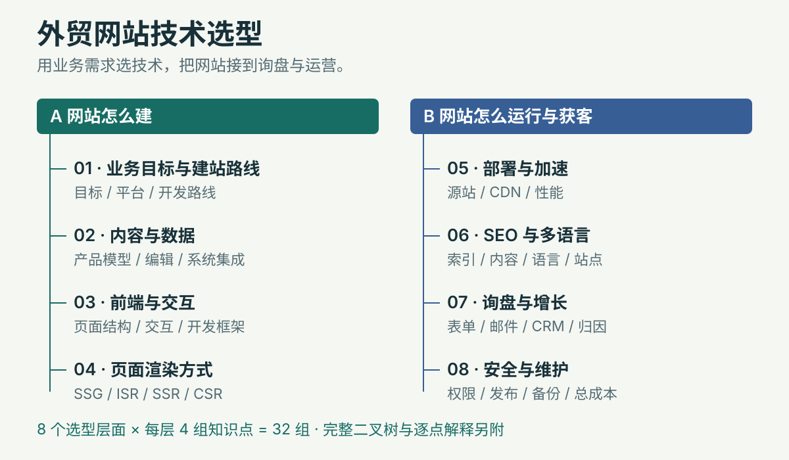

<p align="center">
  
</p>

<p align="center">
  <a href="#快速开始">快速开始</a> ·
  <a href="https://github.com/Miraclemin/b2b-website-strategy/archive/refs/heads/main.zip">下载 ZIP</a> ·
  <a href="https://miraclemin.github.io/b2b-website-strategy/">在线知识图</a> ·
  <a href="./docs/technology-map.md">32 组知识点详解</a> ·
  <a href="./references/example-furniture.md">完整教学案例</a>
</p>

# 外贸网站技术选型与诊断 Skill

**已经有网站，先看清哪些地方值得改；还没网站，先确定适合业务的技术与页面框架。**

把这套 Skill 交给具有文件读取、联网搜索和浏览器能力的 AI 助手，它会按业务条件检查或规划网站，并交付技术选型、竞品功能差距、SEO、插件、邮箱、客服、CDN 接入和缓存规则。

这是可复用的工作流程与参考资料，不是上传网址就自动完成扫描的在线平台。实际研究由运行它的 AI 助手及其工具完成；工具缺失或访问受限时，报告必须说明哪些内容没有验证。

<p align="center">
  <a href="./assets/technology-map.svg"></a>
</p>

**先看实际输出形状：**[酒店家具工厂新站完整教学案例](./references/example-furniture.md)包含七组客户回答、八层方案、配套服务、具体 CDN 规则、SEO 页面结构和验收步骤。案例数据为教学模拟，未做实际市场调研或部署。

## 快速开始

### 方式一：把安装请求交给 AI

适合不想自己敲命令的人。将下面这段发给支持本地 Skills 的 AI 助手：

```text
请把 https://github.com/Miraclemin/b2b-website-strategy
安装为本地 Skill，名称为 b2b-website-strategy。
请按当前工具的 Skill 目录规范安装，保留 SKILL.md、references/、
agents/ 和配套 docs/、assets/，不要只复制首页，也不要覆盖已有同名 Skill。
安装后读取 SKILL.md，告诉我是否可正常使用，以及是否具备联网和浏览器能力。
```

安装不是只粘贴一个 GitHub 链接；助手需要能读取并保存仓库文件。如果当前聊天工具无法安装 Skill，可以下载完整仓库，将 `SKILL.md` 与 `references/` 等资料提供给支持文件读取的助手，再明确要求按它执行。一次只上传 `SKILL.md` 会缺少 CDN、诊断和 SEO 等详细规范。

### 方式二：在 Codex 中手动安装

先安装 Git。以下为 macOS / Linux 的新安装命令，使用 Codex 当前官方说明中的个人 Skill 目录：

```bash
mkdir -p ~/.agents/skills
git clone https://github.com/Miraclemin/b2b-website-strategy.git \
  ~/.agents/skills/b2b-website-strategy
```

Windows PowerShell：

```powershell
New-Item -ItemType Directory -Force "$env:USERPROFILE\.agents\skills" | Out-Null
git clone https://github.com/Miraclemin/b2b-website-strategy.git `
  "$env:USERPROFILE\.agents\skills\b2b-website-strategy"
```

如果已有同名文件夹，`git clone` 会停止；先确认原内容与来源，再决定备份或更新。不要删除原文件夹来强行安装。安装后在新会话中检查是否识别到 `$b2b-website-strategy`；必要时重新打开客户端。团队项目也可按官方规范放进 `.agents/skills/b2b-website-strategy/`。

目录依据：[官方 OpenAI Skills 说明](https://learn.chatgpt.com/docs/customization/overview#skills)。不同工具的目录、安装方式和浏览器权限可能不同；本仓库未逐一验证所有 AI 客户端。

### 第一次使用：已有网站

复制以下提示，替换占位内容。`example.com` 仅用于演示，请填自己的真实网址。

```text
使用 $b2b-website-strategy，诊断我的外贸网站。

网址：https://example.com
产品：酒店家具
主要客户：酒店工程采购、经销商
目标市场：英国、德国
当前问题：访问量没有明显增长，询盘少，不确定要不要重建。
已知竞品：暂无，请按产品、买家和市场找 2–3 个相关候选。

请实际打开本站和候选竞品的代表页面，给我：
1. 最值得优先处理的三件事及页面证据；
2. 八层技术现状，以及保留、局部改造、迁移的比较；
3. 竞品功能与工具线索差距表，区分观察、推测与待核实；
4. 插件、企业邮箱、网站发信、客服和 SEO 方案；
5. 明确的 CDN 选择、接入、缓存与绕过规则、更新和验收方法。

先做只读研究，不提交询盘、不联系真人客服、不修改网站。
后台看不到的内容请标记待核实，不要仅凭页面断言具体插件或渲染方式。
```

只知道网址也可以先开始。助手会先查看能从网页确认的信息，再补问影响判断的业务问题；没有浏览器能力时必须说明限制，不能假称已实访。

### 第一次使用：从零建站

```text
使用 $b2b-website-strategy，为我规划一个外贸询盘网站。

我做酒店家具，主要面向英国与德国的工程采购。
还没有网站，也不懂技术。
请先问几个会影响选型的业务问题，每轮最多三个，复用我已经回答的信息。
不要让我先决定 WordPress、Next.js 或 SSR。

问清后，给一个主方案和一个备选，说明为什么适合、代价是什么、
什么条件变化后需要重新选择。
同时交付页面结构、SEO、插件/服务、邮箱与客服、具体 CDN 缓存配置和验收清单。
```

## 两种入口，怎么工作

| 你的情况 | 助手先做什么 | 交付重点 |
| --- | --- | --- |
| 有网站，想诊断或改版 | 实际查看代表页、必要交互与手机视图；寻找相关竞品 | 页面证据、八层现状、功能/工具线索差距、改进顺序、保留或迁移判断 |
| 没网站，从零规划 | 每轮最多三个问题，通常覆盖七组业务条件 | 一个主方案、一个备选、页面与内容模型、SEO、配套服务、CDN 和验收 |

新站主要问：卖什么与卖给谁、市场与语言、怎样成交、内容与编辑者、是否有旧站、预算与维护条件、必须满足的限制。已经知道的答案不重复问；信息够用就先给方向。

### 能拿到哪些内容

1. **结论与优先级**：先告诉你最值得做的事，再展示证据。
2. **技术选择与备选**：每层写清选什么、为什么、业务例子和维护代价。
3. **竞品差距**：比较采购任务和可见功能；有脚本线索才说明工具可能是什么。
4. **插件与服务**：表单保存、SMTP/API 发信、企业收件箱、Tidio 等客服、SEO、多语言、备份、分析。
5. **CDN 配置**：具体供应商与接入域名、DNS/代理和 TLS、路径/方法/参数/Cookie 条件、边缘/浏览器 TTL、缓存键、规则顺序、发布失效、回退与验收。
6. **SEO 页面蓝图**：采购需求 → 页面类型 → URL → 内容证据 → 询盘入口；文章计划单列。
7. **运行与执行方案**：内容如何更新、询盘如何保存通知和跟进、谁负责维护、怎样验收。

这些是规划与研究交付，不代表已经安装插件、改好 DNS、投递邮件或完成部署。

## 知识图：8 个层面，32 组知识点

“8 层”指八个业务选型层面。配套图按二叉方式组织为 **63 个节点、32 个末端知识点组**，每个非叶节点恰有两个子节点；从根到叶是五次分叉。它是一张分类学习图，多个分支可以组合使用。

| 层面 | 四组核心知识点 |
| --- | --- |
| 01 业务与建站路线 | RFQ 询盘；B2B 交易；CMS/SaaS；框架与一体/Headless 架构 |
| 02 内容与数据 | 内容模型；CMS 编辑发布；数据库/文件/搜索；API/Webhook/集成 |
| 03 前端与交互 | HTML/CSS/JS；响应式与可访问性；组件与样式工具；网站框架 |
| 04 页面渲染与更新 | SSG；ISR；SSR；CSR |
| 05 部署与性能 | 域名/DNS/HTTPS；托管/服务器；CDN/缓存失效；图片脚本与体验性能 |
| 06 SEO 与多语言 | 抓取索引/URL；页面 SEO/内容；国际化/hreflang；单站/多站 |
| 07 询盘与衡量 | RFQ/邮箱/沟通；CRM/分配；分析事件/UTM；有效线索/归因/优化 |
| 08 安全与维护 | 认证授权/密钥隐私；校验防垃圾；Git/测试发布回滚；备份监控/所有权/总成本 |

- [在线交互知识图](https://miraclemin.github.io/b2b-website-strategy/)：缩放、搜索、展开解释、打印；下载后可离线打开。
- [完整 SVG 二叉树](./assets/technology-map.svg)：可缩放、适合继续编辑。
- [高清 PNG 二叉树](./assets/technology-map.png)：便于保存和分享。
- [Markdown 详解与 Mermaid 源图](./docs/technology-map.md)：每点含解释、类比、外贸例子与选型要点。
- [交互 HTML 文件](./docs/technology-map.html)：GitHub 文件页显示源码；下载后在浏览器打开。

## 几个常见误区

**用了 AI，是不是就该从 WordPress 换成 Next.js？**

AI 可以降低初版页面和代码的制作门槛，也能辅助 WordPress 定制主题和可视化建站。选择仍要看编辑流程、业务交互、接口、部署支持和持续维护成本。组件复用是正常工程方式；需要避免的是不同产品照搬同一套内容字段与采购流程。

**SSR、SSG、ISR、CSR 是不是只能选一个？**

可以按页面或区域组合。公开产品资料、登录后的客户报价、筛选器和后台，可能采用不同策略。WordPress 整页缓存和 ISR 有相似效果，也有生成、失效和更新机制上的差异，不能直接画等号。

**有 CDN，还需要欧洲机房吗？**

分别判断。CDN 像各地分仓，源站像总仓；命中副本时可就近交付，没命中与动态请求仍可能回源。按目标买家、实际链路和维护条件选区域，不把欧洲源站设为硬要求。已有托管自带 CDN 时先评估复用。

**能看出竞品用了哪些插件吗？**

只报告可见证据。页面有聊天窗口，不代表能确认具体插件；加载某厂商资源可以支持工具线索，不能证明套餐、完整后台配置或实际投递效果。SSR/SSG/ISR 也可能仅靠公开页面无法区分。

## 使用边界与费用

- Skill 和知识图按 MIT 许可提供；AI 工具、主机、插件、邮箱、客服、CDN 等费用分别由所选服务决定。
- 研究公开页面不等于深入后台。报告需区分确认观察、工具线索、推测、未发现和无法判断。
- 不承诺搜索排名、流量或询盘数量；没有数据时不编造词量、测速、插件版本或报价。
- 默认研究不提交表单、不联系他人、不购买服务、不改 DNS 或发布站点；实施按实际授权开展。
- 不需要提供管理员密码来开始公开网页诊断；后台资料只在确实需要、获得授权时通过适当方式补充。
- 本仓库包含工作流程和教学材料，未内置联网、浏览器、付费数据接口或独立执行的 AI 模型。

## 文件结构

```text
b2b-website-strategy/
├── SKILL.md                         Skill 入口与工作流程
├── agents/openai.yaml               Codex 展示与默认提示
├── references/
│   ├── site-audit.md                现有网站与竞品诊断
│   ├── selection-guide.md           八层选型判断
│   ├── services-and-configuration.md 插件、邮箱、客服
│   ├── cdn-plan.md                  CDN 接入与缓存规则
│   ├── seo-playbook.md              SEO 与证据规范
│   └── example-furniture.md         家具新站教学案例
├── docs/
│   ├── technology-map.html         可离线交互知识图
│   └── technology-map.md           32 组知识点与 Mermaid
├── assets/
│   ├── knowledge-tree.json         知识图可编辑数据源
│   ├── technology-map.svg          完整二叉树
│   └── technology-map.png          高清图片
└── scripts/build_maps.py           用标准库生成图与解释
```

## 更新与维护

如果按上面的 Git 克隆方式安装，并且没有本地修改，可在安装目录执行：

```bash
git -C ~/.agents/skills/b2b-website-strategy pull --ff-only
```

有本地改动时先查看 `git status`、备份并合并，不直接覆盖。知识图修改以 `assets/knowledge-tree.json` 为源，运行 `python3 scripts/build_maps.py` 生成 SVG、HTML 和 Markdown，再重新导出 PNG 并检查图中文字。

本仓库初始发布时已做结构、链接和知识图检查；真实网站诊断仍须在运行时重新访问。供应商价格、套餐、框架支持及官方配置规则，均需按当次任务核对。

## 许可

[MIT License](./LICENSE)。可使用、修改与分发，请保留许可声明。
