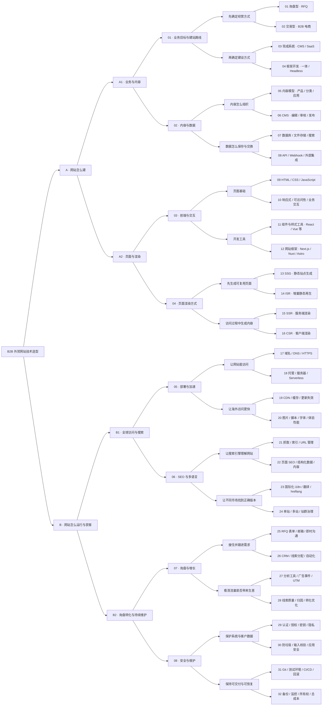

# 外贸网站技术选型 · 8 层 32 组知识点

> “8 层”指八个业务选型层面。图是知识分类二叉树，不是只能沿一个分支走的互斥决策树。

共 63 个节点，32 个末端知识点组，每个非叶节点恰有两个子节点；从根到叶有 5 次分叉。

[交互学习图](technology-map.html) · [完整 SVG](../assets/technology-map.svg) · [高清 PNG](../assets/technology-map.png)

## 完整二叉树

## 32 组知识点详解

### 01 · 业务目标与建站路线

#### 01 · 询盘型 · RFQ

- **是什么**：RFQ 是报价请求。买家提交需求，销售沟通后报价，不必在网站直接付款。
- **类比**：网站像展厅，成交由业务员接着谈。
- **外贸例子**：定制家具：买家提交款式、数量、尺寸、目的港。
- **选型要点**：重点是产品资料、案例、询盘和销售跟进；是否显示价格由业务决定。

#### 02 · 交易型 · B2B 电商

- **是什么**：网站处理客户账户、合同价、最小起订量、下单，以及可能的在线支付或账期。
- **类比**：网站除了展厅，还承担收银台和订货员。
- **外贸例子**：老客户登录后按协议价补货。
- **选型要点**：先核对客户分级、MOQ、阶梯价、税费、运费、账期与 ERP 同步；不是装上购物车就完成了 B2B。

#### 03 · 现成系统 · CMS / SaaS

- **是什么**：CMS 是内容管理系统；SaaS 是由服务商托管的软件。两者可以重叠。WordPress 可自行托管，Webflow、Shopify 是托管平台例子。
- **类比**：选择一套现成店铺设施，再装修。
- **外贸例子**：WordPress 管产品与文章；托管平台提供后台与发布服务。
- **选型要点**：比较编辑体验、扩展能力、数据导出、费用和维护责任。具体功能与套餐应核对当前官方说明。

#### 04 · 框架开发 · 一体 / Headless

- **是什么**：开发框架帮助写网站。一体式把页面与服务放在同一应用；Headless 把内容后台和展示前台分开，通过 API 连接。
- **类比**：前台接待和后台仓库可以一体，也可以分开协作。
- **外贸例子**：Next.js 前台 + WordPress 内容后台；或一个应用同时处理页面与询盘接口。
- **选型要点**：定制能力更强，但要承担开发维护。Headless 是架构，Next.js 是框架，不能当成同一层的二选一。
- **资料入口**：[WordPress REST API](https://developer.wordpress.org/rest-api/)；具体能力以使用时的官方资料为准。

### 02 · 内容与数据

#### 05 · 内容模型 · 产品 / 分类 / 应用

- **是什么**：先定义内容种类、字段及关系：产品有哪些参数，属于什么分类，可用于哪些行业。PIM 是更专门的产品信息管理系统。
- **类比**：先做统一产品资料卡，再批量填内容。
- **外贸例子**：椅子有材质、尺寸、承重、MOQ；产品关联酒店应用和项目案例。
- **选型要点**：字段是否结构化，决定能否筛选、比较、多语言复用和批量导入。避免把所有参数塞进一段正文。

#### 06 · CMS · 编辑 / 审核 / 发布

- **是什么**：让运营通过后台维护内容；可包括草稿、预览、审核、版本与翻译状态。少量内容也可放在 Markdown 文件。
- **类比**：给业务员一张能自己填写和提交的表。
- **外贸例子**：运营改产品参数，审核通过后发布。
- **选型要点**：让真实编辑者试用；评估批量导入、权限、预览、媒体管理。开发者方便不等于运营好用。

#### 07 · 数据库 / 文件存储 / 搜索

- **是什么**：数据库存结构化记录；对象存储放图片、PDF、视频等文件；搜索服务负责检索与筛选。CMS 可能已包含其中一部分。
- **类比**：账本管记录，仓库放文件，目录帮你查找。
- **外贸例子**：产品参数进数据库，说明书进对象存储，按材质和尺寸检索。
- **选型要点**：先看已有系统能否满足；数据量和检索需求增加后再引入独立搜索。并非每个网站都要另建数据库。

#### 08 · API / Webhook / 外部集成

- **是什么**：API 是系统间读取或写入数据的接口；Webhook 是事件发生后主动通知另一个系统。
- **类比**：API 像打电话询问，Webhook 像事情办完主动通知。
- **外贸例子**：ERP 同步库存；CMS 发布后通知前台刷新；询盘传入 CRM。
- **选型要点**：确认数据归谁管、同步方向、身份验证、失败重试和重复数据处理。API 密钥应留在受保护的服务端。

### 03 · 前端与交互

#### 09 · HTML / CSS / JavaScript

- **是什么**：HTML 组织内容与结构，CSS 管外观与布局，JavaScript 管交互逻辑；TypeScript 在 JavaScript 上增加类型检查。
- **类比**：HTML 是骨架，CSS 是装修，JavaScript 让门窗能动。
- **外贸例子**：产品标题与参数表用 HTML；手机布局用 CSS；询盘弹窗用 JavaScript。
- **选型要点**：这几项通常配合使用。TypeScript 不等于渲染方式，也不直接决定 SEO。

#### 10 · 响应式 / 可访问性 / 业务交互

- **是什么**：响应式适配不同屏幕；可访问性让键盘、读屏等用户也能操作；业务交互包括筛选、比较、表单和选型。
- **类比**：同一个展厅，让手机访客和不同使用习惯的人都走得通。
- **外贸例子**：手机可读规格表，键盘可填写询盘；按用途筛选产品。
- **选型要点**：先保证买家查资料和联系顺畅，再决定动画、3D、配置器等增强功能。

#### 11 · 组件与样式工具 · React / Vue 等

- **是什么**：组件是可重复使用的界面模块。React、Vue 帮助组织界面；组件库与 Tailwind 等样式工具帮助统一外观。
- **类比**：把导航、产品卡、按钮做成可重复拼装的积木。
- **外贸例子**：修改一个产品卡组件，各分类页面一起更新。
- **选型要点**：React、Vue 通常是替代选择；组件库和样式工具可配合。它们不等于 CMS 或数据库。

#### 12 · 网站框架 · Next.js / Nuxt / Astro

- **是什么**：框架把路由、构建、数据读取、页面渲染等能力组织起来。Next.js 基于 React，Nuxt 基于 Vue，Astro 支持按需加入交互组件。
- **类比**：组件是积木，框架是帮你搭完整建筑的施工系统。
- **外贸例子**：大量内容页面加少量筛选交互；或官网与客户门户共用一个工程。
- **选型要点**：按内容量、交互、团队能力和部署环境选。不是用了某个框架就自动快，也不是所有部署都支持同样功能。
- **资料入口**：[Astro Islands](https://docs.astro.build/en/concepts/islands/)；具体能力以使用时的官方资料为准。

### 04 · 页面渲染方式

#### 13 · SSG · 静态站点生成

- **是什么**：在构建阶段生成页面，访问时交付已有 HTML；内容更新后可以再次构建。
- **类比**：提前印好产品册，客户来就直接拿。
- **外贸例子**：公司介绍、文章、产品说明；改内容后触发重新构建。
- **选型要点**：适合可提前生成的公开内容。更新不频繁是常见情况，但不代表内容永远不能变。

#### 14 · ISR · 增量静态再生

- **是什么**：复用已生成页面，再按时间或事件等规则使其重新生成；通常不必重建整个网站。具体语义取决于框架与部署。
- **类比**：产品册先备好，改了某款产品就换那几页。
- **外贸例子**：上万产品页面：改一个产品后，触发相关页面更新。
- **选型要点**：适合允许一定内容延迟的公开页面。时间到不一定等于后台定时自动执行；可能要等后续访问触发，访客也可能暂时看到旧版。
- **资料入口**：[Next.js ISR](https://nextjs.org/docs/app/guides/incremental-static-regeneration)；具体能力以使用时的官方资料为准。

#### 15 · SSR · 服务端渲染

- **是什么**：在服务端生成 HTML。与 SSG 对比时，通常指在请求时生成页面；能否复用结果，还取决于缓存规则。
- **类比**：客户来时，后台先准备好展板再端出来。
- **外贸例子**：根据登录客户读取其专属报价，再返回页面。
- **选型要点**：适合依赖请求信息、需要服务端处理的内容。SSR 不自动保证实时；共享缓存也不能混用不同客户的私有数据。

#### 16 · CSR · 客户端渲染

- **是什么**：浏览器运行 JavaScript，获取数据并生成或更新界面。它也可以接在服务器预生成的页面之后。
- **类比**：先摆好工作台，再在访客的浏览器里不断操作。
- **外贸例子**：客户后台、在线选型器、筛选、聊天与订单状态。
- **选型要点**：适合交互与私人区域。公开核心内容若完全依赖 JavaScript，要检查抓取与渲染。Client Component 不等于页面只有 CSR；Hydration 是让已有 HTML 接上交互。
- **资料入口**：[Next.js 服务端与客户端组件](https://nextjs.org/docs/app/getting-started/server-and-client-components)；具体能力以使用时的官方资料为准。

### 05 · 部署与加速

#### 17 · 域名 / DNS / HTTPS

- **是什么**：域名是网址名称；DNS 把名称指向服务；HTTPS 加密浏览器与网站之间的传输。
- **类比**：域名是店名，DNS 是导航指路，HTTPS 是加密运输。
- **外贸例子**：把 example.com 指向网站，并配置有效证书。
- **选型要点**：核对主域名、www 跳转、DNS 归属、续费和证书。域名不等于服务器；邮箱还需要自己的 DNS 配置。

#### 18 · 托管 / 服务器 / Serverless

- **是什么**：托管提供网站的运行位置。可能是静态托管、托管应用平台、传统服务器，或按请求运行的函数。
- **类比**：选店铺落在哪里，以及谁负责水电和维修。
- **外贸例子**：静态内容放静态托管；询盘由函数处理；WordPress 运行在合适的 PHP 与数据库环境。
- **选型要点**：框架需要什么运行能力，托管就必须支持什么。Serverless 仍有服务器，只是由平台管理；检查区域、超时、配额和数据存放位置。

#### 19 · CDN / 缓存 / 更新失效

- **是什么**：CDN 从靠近用户的节点交付可缓存内容；缓存保存可复用结果，失效规则决定何时获取新版。
- **类比**：把常用产品册放进各地分仓。
- **外贸例子**：欧美买家从附近节点加载产品图；发布后清除相关页面缓存。
- **选型要点**：CDN 不是新的建站框架。分别确认页面、数据、浏览器缓存；登录与询盘等私有内容不能随意共享缓存。
- **资料入口**：[Cloudflare CDN 与缓存](https://developers.cloudflare.com/cache/)；具体能力以使用时的官方资料为准。

#### 20 · 图片 / 脚本 / 字体 / 体验性能

- **是什么**：控制资源体积和加载顺序；Core Web Vitals 用 LCP、INP、CLS 观察主要内容显示、交互响应与布局稳定性。
- **类比**：减少运输货物，先把客户最需要的东西搬进来。
- **外贸例子**：压缩大图、提供合适尺寸、延迟非首屏媒体，减少第三方聊天和统计脚本。
- **选型要点**：用目标国家和手机的真实体验验证。静态页面也可能被大图拖慢，SSR 也不能代替资源优化。

### 06 · SEO 与多语言

#### 21 · 抓取 / 索引 / URL 管理

- **是什么**：抓取是搜索引擎读取页面，索引是把页面纳入可检索内容。robots.txt、noindex、状态码、Sitemap、canonical 各有不同作用。
- **类比**：让图书管理员找到书、判断收不收录，并认清哪本是主要版本。
- **外贸例子**：产品链接可正常访问，重要页面有内链；移除产品有合适的跳转或状态码。
- **选型要点**：提交 Sitemap 不保证收录。robots.txt 不是访问权限；仅禁止抓取也不等于一定从搜索结果移除。筛选组合要防止生成无穷重复 URL。
- **资料入口**：[Google JavaScript SEO](https://developers.google.com/search/docs/crawling-indexing/javascript/javascript-seo-basics)；具体能力以使用时的官方资料为准。

#### 22 · 页面 SEO / 结构化数据 / 内容

- **是什么**：页面标题、描述、标题层级、正文、内链和结构化数据帮助用户及搜索引擎理解内容。程序化 SEO 用模板与数据批量生成有实际价值的页面。
- **类比**：书名、目录、正文和分类标签要与内容相符。
- **外贸例子**：产品页提供真实参数、应用案例和常见问题；类目页帮助采购比较。
- **选型要点**：架构支持 SEO，不保证排名。结构化数据应与可见内容一致；批量生成不等于每一页都值得收录。

#### 23 · 国际化 i18n / 翻译 / hreflang

- **是什么**：i18n 是让系统支持多语言与地区差异；本地化是做好具体语言内容；hreflang 标明对应的语言或地区版本。
- **类比**：给不同国家准备对应版本的产品册，再互相标注版本。
- **外贸例子**：example.com/en/ 与 /de/ 有各自 URL，翻译正文、导航、单位和询盘提示。
- **选型要点**：仅装翻译按钮不等于完整多语言 SEO。检查独立 URL、互相关联、语言切换和翻译质量，避免只按 IP 自动切换内容。
- **资料入口**：[Google 多语言网站指南](https://developers.google.com/search/docs/specialty/international/managing-multi-regional-sites)；具体能力以使用时的官方资料为准。

#### 24 · 单站 / 多站 / 站群治理

- **是什么**：一个站可通过目录管理多个语言；也可用子域名或独立域名分开品牌、国家或业务。多站需要管理配置与内容复用。
- **类比**：选择同一家店分楼层，还是开多家分店。
- **外贸例子**：同品牌用语言目录；独立品牌各有域名，共享产品资料但分别维护内容。
- **选型要点**：按品牌、市场、团队和权限选择；域名越多，内容、维护与数据分析工作越多。复制大量相似站点不自动带来更多流量。

### 07 · 询盘与增长

#### 25 · RFQ 表单 / 邮箱 / 即时沟通

- **是什么**：询盘入口收集足够报价的信息；邮件、WhatsApp 或在线聊天提供不同沟通渠道。服务端处理负责校验与提交。
- **类比**：前台把客户需求记完整，再可靠地交给销售。
- **外贸例子**：提交产品型号、数量、国家与附件，网站确认已保存，通知销售。
- **选型要点**：不要只检查提交按钮变绿。核对询盘是否保存、通知是否到达、回复地址是否正确，避免漏单和重复提交。

#### 26 · CRM / 线索分配 / 自动化

- **是什么**：CRM 管客户与商机；自动化将询盘分配给销售、提醒跟进并记录状态。
- **类比**：把前台登记本接到销售团队的客户档案。
- **外贸例子**：按国家分配询盘，销售标记有效、已报价、已成交。
- **选型要点**：先明确线索字段和负责人，再接系统。通知失败不应让已保存询盘丢失；同步要防重复。

#### 27 · 分析工具 / 广告事件 / UTM

- **是什么**：分析工具记录访问和事件；UTM 是链接上的来源标签；广告转化事件记录希望用户完成的动作。
- **类比**：给不同渠道发来的访客贴上来源标签。
- **外贸例子**：记录广告访问后成功提交询盘，而不是只记录点击按钮。
- **选型要点**：区分按钮点击、提交成功、有效询盘与成交。统计可能受同意设置和拦截影响；不要把个人联系资料直接发进分析事件。

#### 28 · 线索质量 / 归因 / 转化优化

- **是什么**：归因尝试关联渠道与结果；转化优化改善资料、信任信息和联系流程，提高目标动作完成率。
- **类比**：不仅数进店人数，还要看谁问价、谁买单。
- **外贸例子**：对比不同广告带来的有效买家比例，以及询盘到成交的情况。
- **选型要点**：访客数和表单数量不能单独代表业务价值。先统一有效线索口径，再讨论渠道回报与页面实验。

### 08 · 安全与维护

#### 29 · 认证 / 授权 / 密钥 / 隐私

- **是什么**：认证确认你是谁，授权确认你能做什么；密钥用于系统访问；隐私管理覆盖收集目的、保存期限和访问范围。
- **类比**：先查身份，再决定能进哪间办公室。
- **外贸例子**：销售可看负责的客户，编辑可改产品，管理员管理账户；客户只看自己的报价。
- **选型要点**：后台和 API 都要检查权限，不能只隐藏按钮。密钥不放公开前端；跟踪和数据收集按目标市场与实际工具核对要求。

#### 30 · 防垃圾 / 输入校验 / 应用安全

- **是什么**：在服务端检查输入、附件和请求频率，防止垃圾询盘与恶意操作；WAF、验证码、限流可作为保护手段。
- **类比**：前台登记要核验内容，保安限制异常闯入。
- **外贸例子**：拒绝异常附件，限制短时间大量提交，修复有漏洞的依赖或插件。
- **选型要点**：浏览器里的必填检查不能代替服务端校验；验证码与 WAF 也不能代替正确的权限和程序设计。

#### 31 · Git / 测试环境 / CI/CD / 回滚

- **是什么**：Git 记录代码版本；测试环境先验证；CI/CD 自动检查与发布；回滚恢复已知正常版本。
- **类比**：装修先看样板间，出问题能切回旧方案。
- **外贸例子**：上线前验证产品、语言、手机和询盘；发布后冒烟检查。
- **选型要点**：代码、数据库、配置和媒体可能分别变更。回滚代码不一定撤销数据变化；提前准备可执行的恢复办法。

#### 32 · 备份 / 监控 / 所有权 / 总成本

- **是什么**：备份保存可恢复数据；监控发现故障；所有权保证账号、域名、源码和数据可交接；总成本包括建设与持续运营。
- **类比**：留钥匙、备份账本、装报警器，并把每月开销算清楚。
- **外贸例子**：定期备份并尝试恢复，监控网站与询盘链路，登记域名和服务续费负责人。
- **选型要点**：比较主机、插件、翻译、外部 API、开发维护和迁移成本。备份成功不代表恢复成功；客户应能接管关键资产。
